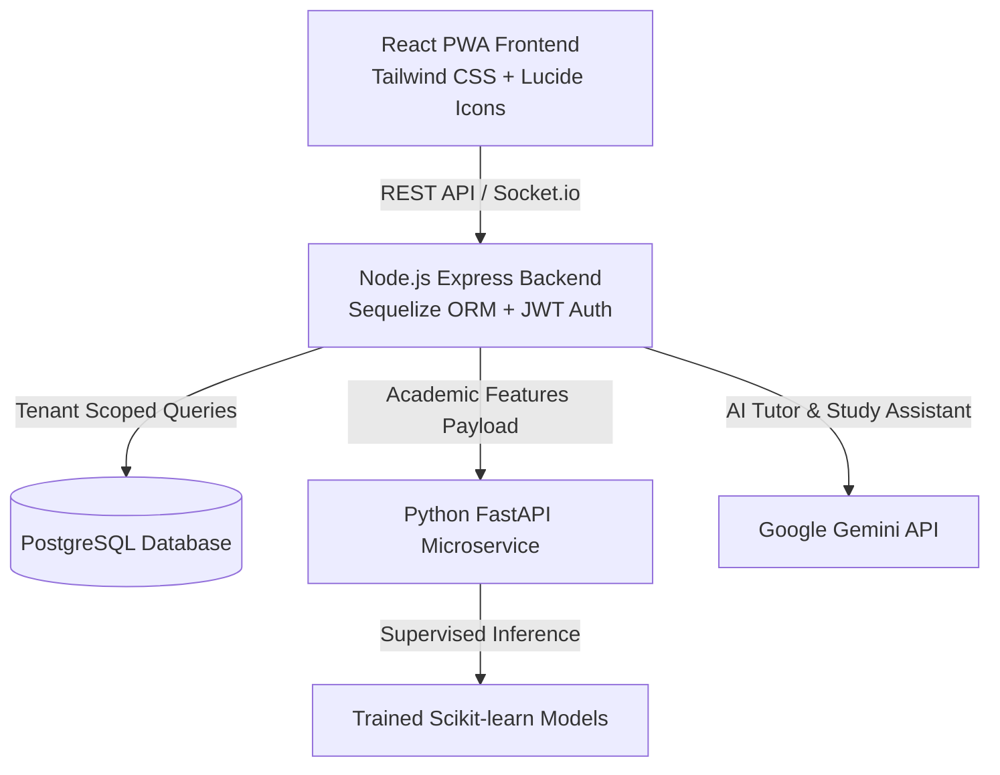

# EduStack Pro — Student-Centered Campus Companion & Academic Success System

> **A final-year engineering project built to replace punitive attendance surveillance with empathetic, early-warning student support.**

---

## 💡 The Human Backstory: Why We Built This

Every semester on our campus, we watched the exact same painful scenario play out:
- Hardworking students were unexpectedly debarred from final examinations because their attendance hovered at 72%—and nobody gave them an early heads-up before it was too late.
- Faculty members were losing 10 to 15 minutes of every single 50-minute lecture just calling out roll numbers and dealing with proxy attendance drama.
- Existing campus portals felt cold, punitive, and anxiety-inducing—treating students like attendance offenders rather than learners who sometimes face illness, transit delays, or burnout.

**We built EduStack Pro to fix this human disconnect.**

Instead of being a digital police tracker, EduStack Pro is designed as a **supportive academic companion**. It automates classroom check-ins to give professors their teaching time back, while using proactive machine learning to identify students who need support weeks before exam week, offering gentle nudges, study buddy connections, and mentor outreach.

---

## 🌟 Core Philosophy: Care Over Punishment

| Traditional Portals | EduStack Pro Philosophy |
| :--- | :--- |
| **"You are a Defaulter"** | **"Here is how many classes you need to be exam-ready"** |
| 15-minute manual roll calls | Fast, secure geofenced check-in & face validation |
| Surprise debarment at exam time | Proactive early-warning forecasting weeks in advance |
| Cold, isolated grade sheets | Integrated peer study buddies & 1-click mentor support |
| Zero wellness awareness | Daily student vibe check-in with motivational pacing tips |

---

## 🎓 Examiner & Viva Defense Guide

### 1. What real-world problem does this project address?
Most college attendance systems only record history; they don't help students recover. EduStack Pro functions as an **early-intervention companion**. It analyzes attendance trajectory, quiz performances, and assignment patterns to flag academic risk *before* the mid-term cut-off, giving students, mentors, and teachers an actionable window to step in and help.

### 2. How does the Machine Learning pipeline work?
The AI engine runs as a lightweight, independent microservice powered by **Python FastAPI** and **Scikit-learn**:
- **Grade Prediction (Regression):** Uses linear and ensemble regressors to estimate projected final grade percentages based on current academic momentum.
- **Academic Risk Classifier:** Classifies student standing into *Low*, *Moderate*, and *Needs Support* categories using feature metrics (attendance percentage, assignment submission frequency, quiz scores, and internal marks).
- **Cold-Start Protection:** If a student just registered and has no academic history, the model gracefully explains that more class sessions are needed rather than hallucinating arbitrary predictions.
- **Explainable Feedback:** Rather than just outputting a percentage, the service highlights the key factor (e.g., *"Your quiz scores are strong, but lab session attendance needs a boost"*).

### 3. What technical hurdles did we encounter and solve?
1. **Multi-tenant data isolation:** Built a PostgreSQL relational model scoped by `collegeId` across all tables so multiple university departments and colleges operate securely within a single installation.
2. **Indoor GPS drift:** Browser geofencing inside multi-story concrete academic buildings can fluctuate. We implemented a hybrid geofence radius paired with time-limited OTP tokens and facial recognition to prevent proxy check-ins without penalizing legitimate students.
3. **Multi-section flexibility:** University branches have multiple parallel batches (e.g., *3rd Year - Section A*, *Section B*). We redesigned class indexing to support composite unique identifiers per college, course, year, and section.

### 4. What is the role-based experience?
- **Students:** Interactive dashboard with time-aware greetings, daily wellness check-ins, exam-eligibility status, study materials, and direct mentor chat.
- **Teachers:** Quick session launcher (QR / OTP / Geofence), real-time class rosters, internal marks entry, and assignment grading.
- **Mentors:** Dedicated leave request approval portal, academic risk monitoring, and one-on-one student guidance.
- **Administrators:** Department/branch management, student and faculty directory, campus coordinate locking, and automated friendly attendance nudges.

---

## 🛠️ System Architecture



---

## 💻 Local Setup & Installation

### 1. Prerequisites
- **Node.js** (v18 or higher)
- **Python** (v3.10 or higher)
- **PostgreSQL** database server

### 2. Start the Backend ML Microservice
```bash
cd backend_ml
python -m venv venv
# On Windows:
venv\Scripts\activate
# On Linux/macOS:
source venv/bin/activate

pip install -r requirements.txt
python generate_data.py
python train.py
python main.py
```
*FastAPI server runs on:* `http://localhost:8000` *(Docs at `/docs`)*

### 3. Start the Express Backend Server
```bash
cd ../backend
npm install
npm run dev
```
*Backend API runs on:* `http://localhost:5000`

### 4. Start the React Frontend Application
```bash
cd ../frontend
npm install
npm run dev
```
*Web App accessible at:* `http://localhost:3005` *(or `http://localhost:5173`)*

---

## 👥 Authors & Academic Context
Built with ❤️ as a Final-Year Computer Science & Applications project. 
Focused on human-centered design, actionable machine learning, and stress-free campus management.
